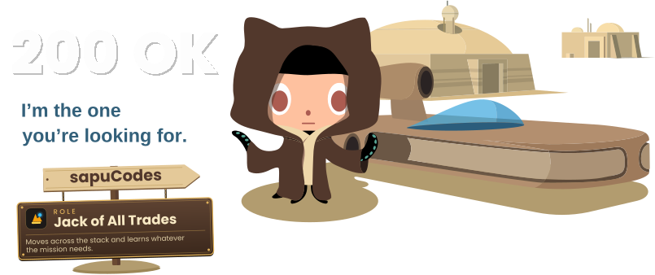

<!-- START: HEADER BANNER & INTRO SECTION -->

<!-- Header Waving Banner -->

<!-- Animated Typing Subtitles -->

<!-- 200 OK Banner -->

 
 
<!-- Profile Views Counter -->

<!-- Header Social Links: Sleek Minimalist Icons -->

<!-- END: HEADER BANNER & INTRO SECTION -->

---

<!-- START: ABOUT ME SECTION -->
<h2 id="about-me">👨‍💻 About Me</h2>

Hi! I'm **Sapumal Prasanna**, a Software Engineering undergraduate at the University of Plymouth, passionate about building practical software solutions and exploring new technologies.

<!-- Quick Bio Bullets -->
- 🎓 BSc (Hons) in Software Engineering (Soon To Be Graduated).
- 💻 Interested in software engineering, web development, and mobile application development (among many other things).
- 📱 Building Flutter applications using Dart.
- 🚗 Developing **SmartRide**, an intelligent vehicle companion for fuel, trips, and driving efficiency.
- ☁️ Experienced in working with VPS's environments and cloud infrastructure.
- 🐧 Interested in networking, automation, and DevOps.
- 🌱 Continuously learning, building projects, and exploring open-source contributions.

<!-- Personal Motto Quote -->
> 🚀 Learn continuously. Build consistently. Improve every day.
<!-- END: ABOUT ME SECTION -->

---

<!-- START: TECH STACK SECTION -->
## 🛠️ Tech Stack

<!-- Programming Languages Stack -->
### 💻 Programming Languages

  

<!-- Web Development Stack -->
### 🌐 Web Development

  

<!-- Mobile & App Dev Stack -->
### 📱 Mobile & Application Development

  

<!-- Databases Stack -->
### 🗄️ Databases & Data Storage

  

<!-- Cloud, Linux & Infrastructure Stack -->
### ☁️ Cloud, Linux & Infrastructure

  

<!-- Extra Cloud Badges -->

  
  

<!-- Design & Dev Tools Stack -->
### 🎨 Design & Development Tools

  

<!-- END: TECH STACK SECTION -->

---

<!-- START: FEATURED PROJECTS SECTION -->
## 🚀 Featured Projects

<table>
  <!-- Row 1: SmartRide & Arcadia -->
  <tr>
    <td width="50%" valign="top">
      <!-- Project 1: SmartRide -->
      <h3>🚗 SmartRide</h3>
      
An intelligent vehicle companion designed to help users manage fuel consumption, trips, and driving efficiency.

      
<strong>Technologies:</strong> Flutter, Dart, Google Maps SDK

      <a href="https://github.com/sapuCodes/SmartRide">View Repository →</a>
    </td>
    <td width="50%" valign="top">
      <!-- Project 2: Arcadia -->
      <h3>📱 Arcadia</h3>
      
An application development project showcasing my work in software development.

      
<strong>Technologies:</strong> See the repository for the project's technology stack.

      <a href="https://github.com/sapuCodes/Arcadia">View Repository →</a>
    </td>
  </tr>
  <!-- Row 2: Noise Pollution Monitoring & Open Source -->
  <tr>
    <td width="50%" valign="top">
      <!-- Project 3: Noise Pollution Monitoring System -->
      <h3>🔊 Noise Pollution Monitoring System</h3>
      
An Arduino-based project for real-time noise pollution monitoring.

      
<strong>Technologies:</strong> Arduino, embedded systems

      <a href="https://github.com/sapuCodes/Noise-Pollution-Monitoring-System---Arduino">View Repository →</a>
    </td>
    <td width="50%" valign="top">
      <!-- Project 4: Open Source & Learning -->
      <h3>🌱 Open Source & Continuous Learning</h3>
      
Exploring open-source projects, improving my programming skills, and learning new development technologies.

      <a href="https://github.com/sapuCodes?tab=repositories">Explore My Repositories →</a>
    </td>
  </tr>
</table>
<!-- END: FEATURED PROJECTS SECTION -->

---

<picture>
  <source media="(prefers-color-scheme: dark)" srcset="https://raw.githubusercontent.com/sapuCodes/sapuCodes/output/pacman-contribution-graph-dark.svg">
  <source media="(prefers-color-scheme: light)" srcset="https://raw.githubusercontent.com/sapuCodes/sapuCodes/output/pacman-contribution-graph.svg">
  
</picture>

<!-- START: GITHUB STATISTICS SECTION -->
## 📊 GitHub Statistics

<!-- General GitHub Stats Card 
 -->

<!-- Most Used Languages Card -->

 

<!-- END: GITHUB STATISTICS SECTION -->

---

<!-- START: CONTRIBUTION ACTIVITY SECTION -->
## 📈 Contribution Activity

<!-- Contribution Graph Widget -->

  

<!-- END: CONTRIBUTION ACTIVITY SECTION -->

---

<!-- START: CONNECT WITH ME & FOOTER SECTION -->

<!-- 200 OK Banner -->

  

<!-- Closing Note -->
💬 Feel free to explore my repositories, connect with me, or collaborate on interesting projects!

**Thanks for visiting my profile! ⭐**

<!-- Header Social Links: Independent Skillicons -->

<!-- Footer Waving Banner -->

<!-- END: CONNECT WITH ME & FOOTER SECTION -->
